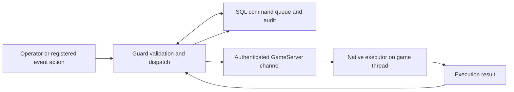

# Architecture and integration issues

## Components

The private implementation separates command validation, durable command/event state, transport, and the native game action. Registration is distinct from execution; execution acknowledgement is distinct from a player's confirmed arrival.

## Current areas of investigation

### DLL loading and process lifecycle

The wider project uses a native integration module in an operator-controlled GameServer process. A GameServer restart can remove a runtime-loaded module. Guard restart and handshake-secret lifecycle have also interrupted the channel in earlier development runs. Readiness must be checked for the current process rather than inferred from an old log or a previously successful build.

### Native GameServer integration

Some functions and object layouts are specific to the tested legacy binary. A wrong ABI, container assumption or object-resolution path can fail or crash the process. Compatibility work therefore uses recorded evidence, bounds and error checks, and separates observation from actual game-state changes. The private implementation's exact offsets, addresses and instrumentation tools are not published here.

### SQL integration

The command/event workflow involves schema installation, stored procedures, queue claims, results, audit records and worker permissions. A SQL result can demonstrate only the stage it records. End-to-end validation must correlate the specific command and current channel with native results and observed event state; old successful rows must not be attributed to a new run.

### Event flow

The intended event flow is notice, player registration, sealed roster, admission requests, countdown, running, results and return/cleanup. Only registered participants are eligible. An offline, loading or otherwise unavailable participant must not stop the whole event indefinitely. Same-GameServer movement has been demonstrated in earlier controlled tests; cross-GameServer movement remains incomplete and must not be presented as delivered.

## Review boundaries

Review concerns SHIELD's own implementation and authorized test activity. Third-party code ownership and the applicable permissions must be evaluated separately. These notes are a development overview, not a security certification, migration implementation or production deployment guide.
